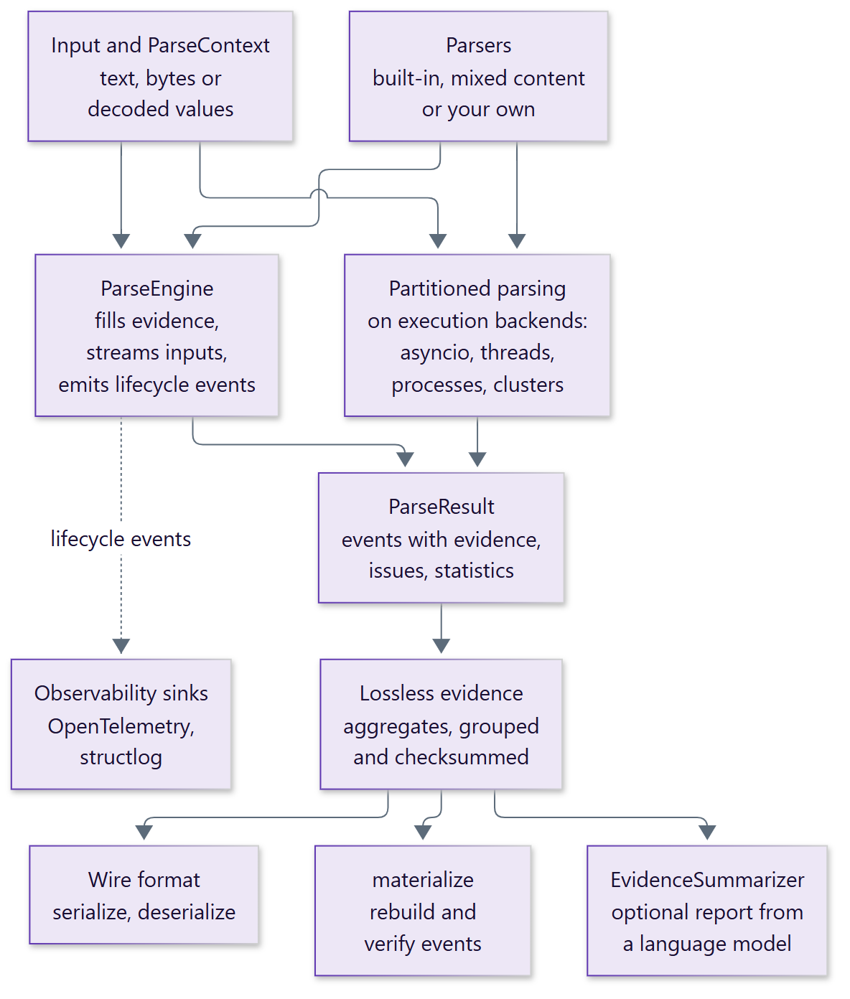

<p align="center">
  
</p>

<h1 align="center">ParseFabric</h1>

<p align="center">
  <a href="https://github.com/smuniharish/parsefabric/actions/workflows/ci.yml"></a>
  <a href="https://parsefabric.readthedocs.io/en/latest/"></a>
  <a href="https://pypi.org/project/parsefabric/"></a>
  <a href="https://pypi.org/project/parsefabric/"></a>
  
  
  <a href="https://github.com/smuniharish/parsefabric/blob/main/LICENSE"></a>
</p>

**Composable parsers that turn logs, JSON, command output and mixed text into
structured events, with evidence for every event and lossless aggregation.**

ParseFabric is an asynchronous Python library for extracting structured events
from operational text. Every event records exactly where it came from: the
source, line number, byte span, matching pattern and parser version. Events
can be stored as compact, checksummed aggregates that rebuild the exact
original events on demand.

## Highlights

- **Evidence on every event.** Trace each finding back to the exact input
  that produced it.
- **Built-in parsers.** Application and timestamped logs, JSON, Python
  tracebacks and command output (through [jc](https://github.com/kellyjonbrazil/jc)).
- **Composable.** Build parsers from regex, exact-value, predicate and
  structured patterns, or write your own parser class.
- **Mixed documents.** Route each line to the right parser, parse fenced
  blocks by language and detect code with tree-sitter. No line is lost.
- **Lossless aggregation.** Store repetitive events compactly in a strict,
  versioned format, then rebuild and verify every original event.
- **Streaming and parallel.** Bounded concurrency, thread and process
  backends, partitioning of large documents, and your own backends for
  clusters.
- **Observable.** Lifecycle events for OpenTelemetry and structlog.
- **Replace any part.** Aggregators, codecs, partitioners, execution
  backends, sinks, language models, tokenizers and more are abstract base
  classes with defaults. Subclass one, pass it in, and verify it with the
  contract checks in `parsefabric.testing`.
- **Checked summaries.** Optional language-model reports over aggregates,
  with every claim checked against the evidence.

## Installation

```bash
pip install parsefabric
```

ParseFabric supports Python 3.12, 3.13, 3.14 and 3.15 on Linux, macOS and Windows.

## Quick example

```python
import asyncio

from parsefabric import ParseContext, ParseEngine
from parsefabric.builtins import ApplicationLogParser

LOG = """\
2026-10-04T08:15:02Z INFO checkout started
2026-10-04T08:15:04Z ERROR payment gateway timed out after 30s
2026-10-04T08:15:09Z ERROR payment gateway timed out after 30s
"""


async def main() -> None:
    engine = ParseEngine()
    parser = ApplicationLogParser()
    context = ParseContext(source_id="checkout.log")

    result = await engine.parse(parser, LOG, context)
    for event in result.events:
        evidence = event.evidence
        print(
            f"{event.event_type:<8} line {evidence.line_number}, "
            f"bytes {evidence.start_offset}-{evidence.end_offset}"
        )

    aggregates = await engine.aggregate(parser, result.events)
    stored = await engine.serialize(aggregates)
    restored = await engine.materialize(parser, LOG, await engine.deserialize(stored), context)
    print("rebuilt exactly:", restored == result.events)


asyncio.run(main())
```

Output:

```text
timeout  line 2, bytes 43-106
error    line 2, bytes 43-106
timeout  line 3, bytes 106-169
error    line 3, bytes 106-169
rebuilt exactly: True
```

## Mixed documents

```python
import asyncio

from parsefabric import ParseEngine
from parsefabric.builtins import JSONParser, MixedContentParser, TimestampedLogParser
from parsefabric.patterns import RegexPattern

parser = MixedContentParser(
    routes=[
        (RegexPattern("log-line", r"^\d{4}-\d\d-\d\dT"), TimestampedLogParser()),
        (RegexPattern("json-line", r"^\{"), JSONParser()),
    ]
)

NOTE = """\
2026-10-01T08:00:02+00:00 ERROR shop database timeout
{"service": "shop", "state": "degraded"}
operator note: failover requested
def retry(order):
    return gateway.charge(order)
"""


async def main() -> None:
    result = await ParseEngine().parse(parser, NOTE)
    for event in result.events:
        print(event.evidence.line_number, event.event_type, event.evidence.parser_name)


asyncio.run(main())
```

Output:

```text
1 log timestamped-log
2 json_record json
3 other mixed-content
4 code mixed-content
5 code mixed-content
```

## How it fits together



## Downloads

<p>
  <a href="https://clickpy.clickhouse.com/dashboard/parsefabric"></a>
  <a href="https://clickpy.clickhouse.com/dashboard/parsefabric"></a>
  <a href="https://clickpy.clickhouse.com/dashboard/parsefabric"></a>
  <a href="https://clickpy.clickhouse.com/dashboard/parsefabric"></a>
</p>
<p>
  <a href="https://clickpy.clickhouse.com/dashboard/parsefabric"></a>
  <a href="https://clickpy.clickhouse.com/dashboard/parsefabric"></a>
  <a href="https://clickpy.clickhouse.com/dashboard/parsefabric"></a>
  <a href="https://clickpy.clickhouse.com/dashboard/parsefabric"></a>
  <a href="https://clickpy.clickhouse.com/dashboard/parsefabric"></a>
  <a href="https://clickpy.clickhouse.com/dashboard/parsefabric"></a>
  <a href="https://clickpy.clickhouse.com/dashboard/parsefabric"></a>
  <a href="https://clickpy.clickhouse.com/dashboard/parsefabric"></a>
  <a href="https://clickpy.clickhouse.com/dashboard/parsefabric"></a>
  <a href="https://clickpy.clickhouse.com/dashboard/parsefabric"></a>
  <a href="https://clickpy.clickhouse.com/dashboard/parsefabric"></a>
  <a href="https://clickpy.clickhouse.com/dashboard/parsefabric"></a>
  <a href="https://clickpy.clickhouse.com/dashboard/parsefabric"></a>
  <a href="https://clickpy.clickhouse.com/dashboard/parsefabric"></a>
  <a href="https://clickpy.clickhouse.com/dashboard/parsefabric"></a>
  <a href="https://clickpy.clickhouse.com/dashboard/parsefabric"></a>
  <a href="https://clickpy.clickhouse.com/dashboard/parsefabric"></a>
  <a href="https://clickpy.clickhouse.com/dashboard/parsefabric"></a>
  <a href="https://clickpy.clickhouse.com/dashboard/parsefabric"></a>
</p>

Download counts come from the public
[ClickHouse PyPI dataset](https://clickpy.clickhouse.com/dashboard/parsefabric),
which refreshes daily. Shields caches badge images for up to an hour, and
GitHub may cache them longer. Weeks start on Monday (UTC). Explore interactive
charts on the [ClickPy dashboard](https://clickpy.clickhouse.com/dashboard/parsefabric).

## Documentation

The full documentation is at
**[parsefabric.readthedocs.io](https://parsefabric.readthedocs.io/en/latest/)**.

| Topic | Link |
| --- | --- |
| Install and first steps | [Installation](https://parsefabric.readthedocs.io/en/latest/getting-started/installation/), [Quickstart](https://parsefabric.readthedocs.io/en/latest/getting-started/quickstart/) |
| How parsing, evidence and aggregation work | [User guide](https://parsefabric.readthedocs.io/en/latest/guide/parsing/) |
| Runnable examples with their output | [Examples](https://parsefabric.readthedocs.io/en/latest/examples/) |
| Writing your own components | [Extending ParseFabric](https://parsefabric.readthedocs.io/en/latest/extending/) |
| Every public class and function | [API reference](https://parsefabric.readthedocs.io/en/latest/reference/) |
| Security, failure handling and performance | [Operations](https://parsefabric.readthedocs.io/en/latest/operations/security/) |
| Using ParseFabric with AI coding agents | [Agent Skills](https://parsefabric.readthedocs.io/en/latest/agent-skills/) |

## Contributing

Contributions are welcome. See the
[contributing guide](https://github.com/smuniharish/parsefabric/blob/main/CONTRIBUTING.md)
for the development setup and checks, and the
[code of conduct](https://github.com/smuniharish/parsefabric/blob/main/CODE_OF_CONDUCT.md).
Report security issues privately as described in the
[security policy](https://github.com/smuniharish/parsefabric/blob/main/SECURITY.md).

## License

ParseFabric is licensed under the
[Apache License 2.0](https://github.com/smuniharish/parsefabric/blob/main/LICENSE).
